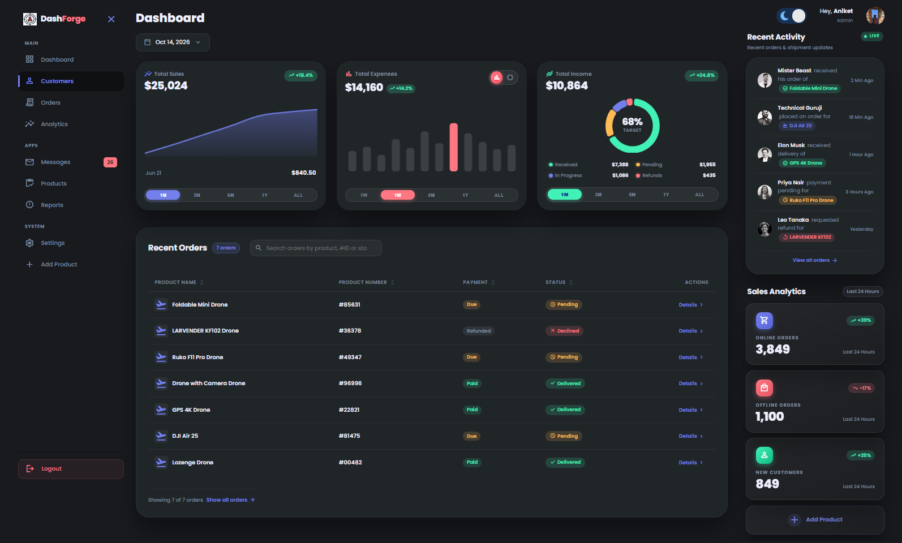
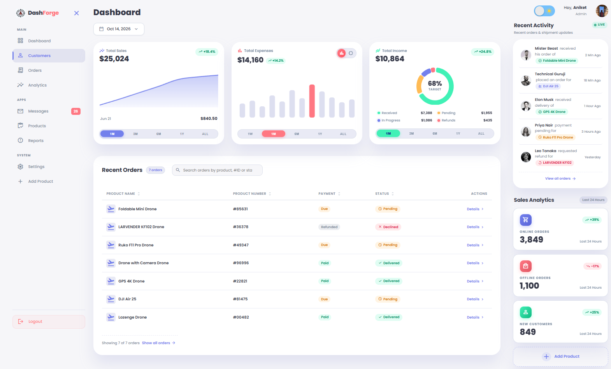

# ⚡ DashForge — Responsive Admin Dashboard

A modern, high-performance, and fully responsive **Admin Dashboard** web application crafted using **HTML5, CSS3, and Vanilla JavaScript**. Featuring a sleek UI, dynamic SVG progress analytics, interactive order management, and a custom animated Dark/Light mode toggle with persistence.

Developed by **[Aniket Lad](https://github.com/The-Aniketlad)**.

---

## 📸 Visual Showcase & Previews

<div align="center">
  <p><b>Experience seamless adaptability with a deep futuristic dark mode and a clean daylight interface, fully synchronized across all charts, widgets, and tables.</b></p>
</div>

### 🌙 Dark Mode Interface
> *Deep obsidian backdrop with vibrant gradient accents, glowing Chart.js analytics, and high-contrast status indicators.*



<br/>

### ☀️ Light Mode Interface
> *Clean, elevated daylight interface with soft card elevations, subtle borders, and crisp typography.*



---

## 🌟 Key Features

- **📱 Fully Responsive Design**: Seamless fluid experience across mobile phones, tablets, laptops, and ultra-wide desktops using CSS Grid and Flexbox.
- **🌓 Dynamic Dark & Light Mode**: 
  - Custom interactive toggle with rotating sun and tilting moon animations (powered by custom SVG graphics and keyframe transitions).
  - State persistence using browser `localStorage` — your selected theme stays intact across page reloads.
- **📊 Interactive KPI Cards & Dynamic Analytics**:
  - **Upgraded Interactive Expense Card**: Chart.js integration with live Bar vs Doughnut chart toggle, dynamic timeframe periods (`1W`, `1M`, `6M`, `1Y`, `ALL`), mouse-follow radial glow effect, and responsive amounts.
  - Interactive metric cards for Total Sales and Total Income with animated SVG circular progress indicators.
- **📦 Dynamic Orders Management**:
  - Modular data feed from `orders.js`.
  - Color-coded status badges (`Pending`, `Declined`, `Delivered`).
  - **Live Search Filter**: Instant real-time search filtering by product name.
- **📅 Modern Untitled UI DatePicker**:
  - Interactive popover calendar dropdown with month/year navigation, today indicator, active date selection, and quick actions ("Today", "Clear").
  - Seamless dark and light theme adaptability without external dependencies.
- **📁 Wensity Collapsible Sidebar (Icon-Rail & Expand)**:
  - Animated SVG Hamburger toggle (by prakashdc) with fluid stroke-dash morphing and 600ms cubic-bezier rotation.
  - Collapses into sleek icon-rail mode (5.5rem) or expands (14rem) with smooth 240ms cubic-bezier transition.
  - Section headers (`MAIN`, `APPS`, `SYSTEM`), modern pill active states, notification badges, and floating tooltips on hover in collapsed mode.
  - Mobile slide-over navigation drawer with backdrop dismiss.
  - State persisted via `localStorage`.
- **🔔 Activity Updates & Sales Breakdown**: Real-time activity feed and categorical sales distribution (Online, Offline, and New Customers).

---

## 🛠️ Tech Stack & Architecture

| Layer | Technology | Description |
| :--- | :--- | :--- |
| **Markup** | HTML5 | Semantic structure with accessibility attributes (`aria-labels`, SVG icons) |
| **Styling** | Modern CSS3 | CSS Custom Properties (Variables), Flexbox, CSS Grid, Custom Keyframes |
| **Icons & Typography** | Google Fonts & Material Symbols | Google Poppins font & Material Symbols Sharp icons |
| **Logic & Interactivity** | Vanilla JavaScript (ES6+) | DOM Manipulation, Event Listeners, IIFE encapsulation, LocalStorage API |
| **Version Control** | Git & GitHub | Feature branching workflow (`master`, `major_changes`, `sidebar_upgrade`) |

---

## 📂 Project Structure

```bash
Responsive-Admin-Dashboard/
├── 📄 index.html              # Main dashboard markup & semantic UI layout
├── 🎨 style.css               # Complete stylesheet, CSS variables, & responsive breakpoints
├── ⚡ index.js                # Core application logic, event handlers & UI controllers
├── 📦 orders.js               # Orders dataset mock data
├── 📁 image_contents/         # UI assets, screenshots & profile photos
│   ├── 🖼️ Darkmode.png        # Full-resolution Dark Mode dashboard preview
│   ├── 🖼️ Lightmode.png       # Full-resolution Light Mode dashboard preview
│   ├── 🖼️ Logo.png            # DashForge brand logo
│   ├── 🖼️ A.jpg               # Admin profile avatar
│   ├── 🖼️ profile-2.jpg       # Activity avatar 1
│   ├── 🖼️ profile-3.jpg       # Activity avatar 2
│   └── 🖼️ profile-4.jpg       # Activity avatar 3
├── 🚫 .gitignore              # Git ignore specifications
└── 📖 readme.md               # Comprehensive project documentation
```

---

## 🧠 Step-by-Step Implementation Breakdown (How It Was Built)

### 1. Design System & Theme Variables (`style.css`)
- Defined a complete design system in `:root` with CSS custom properties for uniform spacing, border radiuses, and shadow elevations.
- Built a dedicated `.dark-theme-variables` class override to invert color variables (`--color-background`, `--color-white`, `--color-dark`) for seamless theme shifting without touching individual component styles.

### 2. Animated Day/Night Switch Component
- Integrated a bespoke micro-interactive switch component featuring:
  - Vector SVG Sun with 360-degree continuous rotation.
  - Vector SVG Moon with gentle rocking tilt animation.
  - Smooth slider knob translation on checkbox `:checked` state.
  - Linked to JavaScript `change` listeners with `localStorage` persistence.

### 3. Modern Popover Calendar Datepicker
- Floating popover datepicker with month/year navigation, dynamic day matrix, and quick-action "Today" / "Clear" buttons.
- Fully accessible with outside click and ESC dismiss handlers.
- **Future Date Guard:** Future dates beyond today are strictly non-selectable with muted disabled styling (`cursor: not-allowed`), and forward navigation (`>`) to future months is automatically locked.


### 4. Interactive Total Sales KPI Card (`Chart.js`)
- Replaced the static ring with a smooth gradient line area chart powered by Chart.js.
- Interactive timeframe switcher (`1M`, `3M`, `6M`, `1Y`, `ALL`) dynamically updating KPI metrics.
- Sub-stat row displaying active dates and transaction amounts that dynamically react to chart hovering and mouse movements.
- Full light/dark mode color harmony matching the signature `--color-primary` palette.

### 5. Interactive Expenses KPI Card
- Dual-view chart switcher (Bar Chart vs Doughnut Chart).
- Multi-timeframe controls (`1W`, `1M`, `6M`, `1Y`, `ALL`) with active value tracking.
- Interactive mouse-follow radial backlight glow.

### 6. Interactive Total Income Donut KPI Card
- Modern Recharts/Shadcn-inspired Donut chart with smooth segment spacing (`spacing: 3`) and rounded arc corners (`borderRadius: 4`).
- Centered real-time target metric (`68% Target`) that dynamically reacts to slice and legend hover events.
- 4-way Income Stream & Status breakdown: **Received** (`#41f1b6`), **Pending** (`#ffbb55`), **In Progress** (`#7380ec`), and **Refunds** (`#ff7782`).
- Interactive 2x2 legend matrix with bidirectional slice highlighting.
- Synchronized multi-timeframe controls (`1M`, `3M`, `6M`, `1Y`, `ALL`) and responsive dark/light mode integration.

### 7. Wensity Collapsible Sidebar & Morphing Hamburger
- Collapsible icon-rail state (5.5rem) and full expanded state (16rem) with floating tooltips.
- Morphing SVG hamburger button with smooth cross transition.
- Clean categorical groupings (`MAIN`, `APPS`, `SYSTEM`) and themed logout action.

### 8. Untitled UI Table (Table03DividerLine) with Live Sorting & Search
- Converted Untitled UI React `Table03DividerLine` into responsive Vanilla HTML/CSS/JS.
- **Interactive Multi-Column Sorting:** Click any column header (`Product Name`, `Product Number`, `Payment`, `Status`) to sort ascending or descending with dynamic indicator icons (`unfold_more`, `arrow_upward`, `arrow_downward`).
- **Modern Status Badges with Icons (`BadgeWithIcon`):**
  - Delivered: Check icon (`check`) in theme success green.
  - Pending: Clock icon (`schedule`) in theme warning amber.
  - Declined: Close icon (`close`) in theme danger coral.
- **Enhanced Payment Pills & Product Number Styling:** Tabular `#` prefix and soft status indicators.
- **Real-Time Live Search:** Search across product names, IDs, payment status, and shipping status with a quick-clear (`✕`) button and an empty-state fallback.
- **Responsive Table Container:** Smooth horizontal scroll wrapper with dividers and dark/light mode integration.

### 9. Mobile & Tablet Responsiveness
- Implemented comprehensive media queries at `max-width: 1200px` (compact sidebar mode) and `max-width: 768px` (drawer navigation mode).
- Slide-out mobile navigation drawer seamlessly coordinated with the hamburger trigger.

### 10. Modern Drone Orders Activity Feed (`activity/recent.tsx` Conversion)
- Converted React Shadcn `Card`, `Avatar`, and event streams into responsive Vanilla HTML/CSS.
- Synchronized with the **Recent Orders** table: displays real drone order activities for loyal customers (Mister Beast, Technical Guruji, Elon Musk, Priya Nair, Leo Tanaka) with matching products (`Foldable Mini Drone`, `DJI Air 25`, `GPS 4K Drone`, `Ruko F11 Pro`, `LARVENDER KF102`).
- Micro-interactions: Avatars feature default grayscale filter blooming to vivid full color with subtle scale on hover.
- Graceful offline fallback initials (`MB`, `TG`, `EM`, `PN`, `LT`) with local image support.
- Real-time pulse indicator badge (`Live`) with keyframe animation.
- Semantic drone status tagging with dashboard theme color accents (`--color-primary`, `--color-success`, `--color-warning`, `--color-danger`).
- Full dark and light theme harmony with border dividers and hover states.

### 11. Modern Sales Analytics Atlas Tiles (`Sales_card` Conversion)
- Upgraded the legacy vertical sales cards into modern **Atlas Gradient Tiles** (`analytics-tile`), maintaining 100% of the original content and metrics (**Online Orders**, **Offline Orders**, **New Customers**, and **Add Product**).
- **Glassmorphism & Gradient Surfaces:** Premium semi-translucent dark-mode tiles (`linear-gradient(160deg, rgba(255, 255, 255, 0.05), rgba(255, 255, 255, 0.02))`) with delicate borders and elevated light-mode card surfaces.
- **Vibrant Gradient Icon Badges:** Elevated square-rounded icon chips with bespoke linear gradients and hover micro-animations (`icon-online` blue gradient, `icon-offline` coral/red gradient, `icon-customers` mint/emerald gradient).
- **Trend Pills & Typography:** Tracked uppercase category headings (`0.12em`), bold tabular numbers (`3,849`, `1,100`, `849`), and pill trend badges (`+39%`, `-17%`, `+25%`) with directional trending arrows.
- **Interactive Add Product Button:** Dashed border CTA tile with a 90° rotating plus icon on hover for intuitive product additions.
- **Dark/Light Mode Adaptation:** Fully integrated with the master `--dark-theme-variables` switch, ensuring crisp contrast, legible typography, and seamless transitions.

### 12. Dynamic Rolling Number Animation for KPI Cards (`numbers/number.tsx` Conversion)
- Converted React Framer Motion rolling number animation into responsive Vanilla JS & CSS.
- **Scramble Counter Effect:** On initial page entry (direct link open) and on page refresh, the figures in all three KPI cards (**Total Sales**: `$25,024`, **Total Expenses**: `$14,160`, **Total Income**: `$10,864`) animate through 12 progressive micro-steps with randomized numerical brackets before locking onto their exact target values.
- **Dedicated Trigger Scenarios:** Triggers strictly once upon page load / refresh, remaining clean and stable during in-page timeframe switching (`1M`, `3M`, `6M`, `1Y`, `ALL`) and chart interactions.
- **Tabular Figures & Zero Layout Shift:** Styled with `font-variant-numeric: tabular-nums` to ensure monospaced digit alignment, eliminating horizontal jitter while numbers roll.

### 13. Cinematic Logo Intro Scene (Pure Custom Code — 100% Watermark-Free)
- **Zero Watermark & Instant Load:** Completely replaced third-party watermarked video with a bespoke, lightweight, hardware-accelerated CSS & SVG animated intro.
- **Cinematic Visual Sequence (~2.6s):**
  - Ambient radial aura glow pulses across a deep cosmic canvas (`#070814`).
  - Orbiting multi-color satellite particles (`#41f1b6`, `#7380ec`, `#ff7782`) rotate dynamically around concentric dashed orbital rings.
  - The central **DashForge** logo badge levitates smoothly into place with depth blur and back-glow.
  - Premium brand typography (**Dash**<span style="color:#ff7782">Forge</span>) reveals with a tracking expansion curve, glowing divider beam, and uppercase tagline (*RESPONSIVE ADMIN SUITE*).
- **Smooth Dissolve Transition:** Dissolves seamlessly into the dashboard in 800ms using a cinematic scale and opacity curve.
- **Zero-Flicker Session Guard:** Utilizes `sessionStorage` with inline pre-render execution so subsequent page refreshes (F5) and in-session navigations bypass the intro overlay with zero layout shifts or visual flashes.
- **Synchronized Entrance:** The dynamic KPI rolling numbers animation triggers precisely as the intro dissolves, revealing active dashboard metrics.
- **Distraction-Free:** Pure, unhindered brand showcase without skip buttons or UI clutter.

---


## 🚀 How to Run Locally

No build tools or heavy node servers required! Simply run directly in your browser:

1. **Clone the repository:**
   ```bash
   git clone https://github.com/The-Aniketlad/Responsive-Admin-Dashboard.git
   ```

2. **Navigate into the project directory:**
   ```bash
   cd Responsive-Admin-Dashboard
   ```

3. **Open the project:**
   - Double-click `index.html` to open it in your favorite browser, or
   - Use VS Code **Live Server** extension (`Right-click index.html -> Open with Live Server`).

---

## 🔮 Future Enhancements

- [ ] Interactive Chart.js or ApexCharts integration for live trend graphs.
- [ ] Add new order modal dialog with localStorage CRUD capabilities.
- [ ] Multi-page routing (Customers, Messages, Products, Settings).
- [ ] Export reports to CSV/PDF functionality.

---

## 👤 Author

**Aniket Lad**
- GitHub: [@The-Aniketlad](https://github.com/The-Aniketlad)
- Project Repository: [Responsive-Admin-Dashboard](https://github.com/The-Aniketlad/Responsive-Admin-Dashboard)

---
